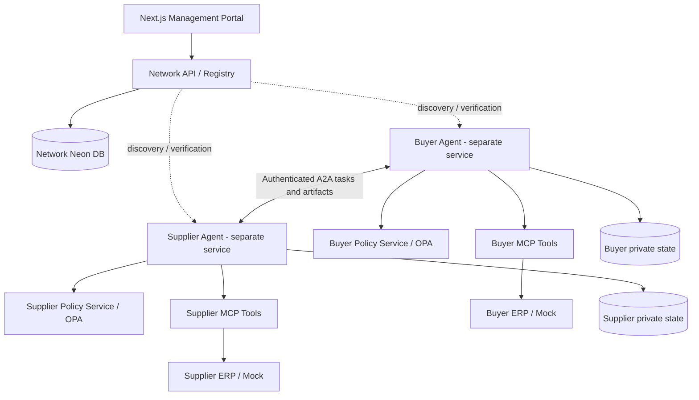

# Architecture and Deployment

## Logical topology



In a managed environment, separate Neon databases or rigorously isolated schemas/roles may implement the three stores. Self-hosted agents use their own storage. **No cross-organization SQL joins to exchange business data.**

## Deployables

- `apps/network-api`: registry, organization metadata, trading relationships, public protocol schemas, authorization metadata and approval API.
- `apps/buyer-agent`: independent A2A endpoint, LangGraph workflow, buyer MCP client, buyer policy client and private state.
- `apps/supplier-agent`: independent A2A endpoint, LangGraph workflow, supplier MCP client, supplier policy client and private state.
- `apps/worker`: retry, timeout, inbox/outbox dispatch and reconciliation.
- `apps/portal`: Next.js management UI; Vercel.
- `services/opa`: isolated policy decisions; separate bundles and scopes per organization.
- `industries/food-wholesale`: RFQ, quote, substitution and order schema, mocks and adapters.

## Proposed repository layout

```text
aimo-brain/
  apps/
    network-api/
    buyer-agent/
    supplier-agent/
    worker/
    portal/
  packages/
    agent-runtime/
    a2a-integration/
    mcp-integration/
    identity/
    authorization/
    trade-protocol/
    audit/
    database/
  industries/
    food-wholesale/
      schemas/
      adapters/mock/
      adapters/valio-aimo/  # only after permission and API access
  infrastructure/
    docker/
    railway/
    vercel/
  tests/
    contracts/
    integration/
    security/
    e2e/
  docs/
```

## Persistence

**Network database:** organizations, agents, endpoint verification, capabilities, relationships, trust status, policy metadata, approval references, minimal network audit.

**Agent-owned databases:** task/checkpoint state, private prompts and tool results where permitted, inbox/outbox, quotes/agreements, approval evidence, external order references and audit. Prefer separate DB roles and encryption boundaries. Supplier ERP remains authoritative for stock, prices and orders; never treat a cached snapshot as authoritative at commit time.

**Object store:** large artifacts, attachments, signed evidence; metadata and checksums in Postgres.

**Redis:** ephemeral scheduling and worker coordination, not the source of truth for commitments. Durable task state and transactional outbox reside in Postgres.

## Deployment choices

1. **Managed:** two separately deployable Railway services and isolated Neon storage, Vercel portal. First implementation.
2. **Customer-hosted:** customer runs container and private storage/policy service; connects through public A2A endpoint or authorized relay.
3. **Bring-your-own-agent:** external A2A implementation registers and uses published business schemas. No AIMO SDK dependency required.

## Service contracts

Use OpenAPI for management endpoints and JSON Schema for business artifacts. A2A SDK handles A2A envelope/task semantics. MCP SDK handles tool transport. AIMO BRAIN defines **business payloads**, not a replacement for either standard.

## Operational boundaries

Use HTTPS/TLS, authenticated agent-to-agent calls, per-org policy evaluation, endpoint allowlisting or SSRF protections, network rate limits, scoped secret access and structured logs. Route private traffic directly where possible. Registry outage should not invalidate already established, cached and unexpired trusted endpoint configuration, but revocation must be enforced with bounded cache lifetimes.
