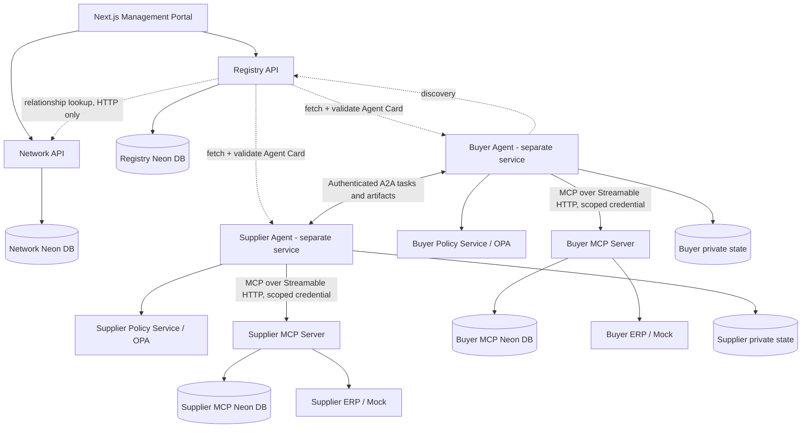

# Architecture and Deployment

## Logical topology

As of M2 (see `docs/DECISIONS.md` ADR-008), the single "Network API /
Registry" box below is split into two independently deployable services:
`network-api` (organization identity, trading relationships, service
credentials) and `registry-api` (agent registration, Agent Card
validation, capability discovery, endpoint-ownership verification,
lifecycle). They never share a database; registry-api's only
cross-service call is a read-only, internal-service-key-authenticated
relationship lookup against network-api's own HTTP API.

As of M3 (see `docs/DECISIONS.md` ADR-009), each agent's business tools
(catalogue/inventory/pricing for supplier; purchase requirements/budget
for buyer) are served by their own independently deployable MCP server —
`buyer-mcp`/`supplier-mcp` — over the official MCP SDK's Streamable HTTP
transport. Each agent calls only its own organization's MCP server,
authenticated with a network-api-issued scoped service credential; no
agent imports a tool implementation directly.

As of M4 (see `docs/DECISIONS.md` ADR-010), buyer-agent and
supplier-agent negotiate a nonbinding RFQ/quote/counterproposal/
proposed-agreement sequence over the same direct A2A connection used for
product availability — no new transport or service. Each agent persists
its own negotiation/proposal history in its own database (own
migration, no new service); the negotiation state machine reuses M0's
generic `trade_protocol.TradeState`/`VALID_TRANSITIONS` rather than a
new one. Nothing in M4 can reach `AUTHORIZED` or later — that remains
M5 scope, gated on independent OPA policy checks that do not exist yet.

As of M5 (see `docs/DECISIONS.md` ADR-011), both agents independently
evaluate their own versioned OPA bundle (`packages/policy_engine`, a
bounded `opa eval` subprocess wrapper — no new network service) over the
exact proposed-agreement terms, create a durable approval request when
their policy requires human sign-off, and exchange credential-verified
`authorization_evidence` over the same direct A2A connection used for
negotiation. Once both sides hold matching, allowed evidence for the
identical `content_hash`, the buyer sends an idempotent
`order_commit_request`; the supplier calls its own `supplier-mcp`'s new,
narrowly-scoped `execute_order` tool (the approved mock order adapter)
and replies with `order_confirmation`. `TradeState.AUTHORIZED` through
`COMMITTED` are now real, reachable states — gated on independent policy
decisions, not a default or an LLM's own judgement.

As of M5.1 (see `docs/DECISIONS.md` ADR-012), every negotiation and
commitment artifact — not just M5's three authorization/commitment
types — carries a per-artifact JWS `proof` (`packages/message-integrity`),
signed with the sending organization's own Ed25519 key and verified by
the receiver against that organization's published JWKS before any
business handler runs. `network-api` publishes public JWKS only
(`GET /organizations/{id}/jwks.json`) and never again holds a secret
whose compromise lets anyone forge a message for another organization —
replacing M5's shared-HMAC-secret `commit`/`negotiate`/`approve`
credentials entirely. `registry-api` gained a direction-agnostic
`GET /agents/{id}/verify-sender` so either side (not only the buyer, as
M2's discovery endpoint assumes) can confirm a verified sender is a
registered, active agent with an active trading relationship. Human
approval now runs through a clearly-labeled development identity
adapter (`identity.dev_oidc`) rather than a bare credential, refused
outright outside local/staging. `apps/worker` is real for the first
time: a role-parameterized (`WORKER_ROLE=buyer|supplier`) process that
retries a crashed/ambiguous buyer-side commit by re-invoking the same
idempotent entry point a live request already uses.



In a managed environment, separate Neon databases or rigorously isolated schemas/roles may implement each store. Self-hosted agents use their own storage. **No cross-organization SQL joins to exchange business data, and no cross-*service* database access either** — registry-api and network-api each own one database and talk to each other only over HTTP.

## Deployables

- `apps/network-api`: organization identities, organization-level trading relationships, short-lived organization-scoped service-credential issuance (intra-organization scopes only as of M5.1), public protocol schemas, and — as of M5.1 — each organization's public signing-key directory (`organization_signing_keys`, `GET /organizations/{id}/jwks.json`). Never receives or stores a private key.
- `apps/registry-api`: agent registration, Agent Card fetch/validation (SSRF-safe), capability indexing, endpoint-ownership verification, agent lifecycle (pending/active/suspended/revoked), capability-indexed discovery (gated by a trading relationship looked up from network-api), registry audit trail. Never proxies an A2A conversation — discovery returns the real A2A endpoint URL, and agents talk to each other directly.
- `apps/buyer-agent`: independent A2A endpoint, LangGraph workflow, buyer MCP client (calls `apps/buyer-mcp` only), nonbinding RFQ/counteroffer negotiation (M4, own negotiation/proposal tables), independent OPA policy evaluation, durable human approval and authorization-evidence exchange (M5, own `buyer_approvals`/`buyer_authorization_evidence`/`buyer_orders` tables), and private state.
- `apps/supplier-agent`: independent A2A endpoint, LangGraph workflow, supplier MCP client (calls `apps/supplier-mcp` only), nonbinding quote/counteroffer negotiation (M4, own negotiation/proposal tables plus an inbound-artifact replay-dedup cache), independent OPA policy evaluation, durable human approval and authorization-evidence exchange, and commitment handling that calls its own `supplier-mcp`'s execution tool (M5, own `supplier_approvals`/`supplier_authorization_evidence`/`supplier_orders` tables), and private state.
- `apps/buyer-mcp`: buyer organization's own MCP tool server (purchase requirements, budget, approved suppliers, purchase approval — a mock decision, not OPA). Independently deployable; own database (tool-invocation audit log); scoped-credential-authenticated; never serves any other organization.
- `apps/supplier-mcp`: supplier organization's own MCP tool server (catalogue search, inventory, customer price, delivery options — read-only, `use_supplier_tools` scope). As of M5, also exposes `execute_order`/`get_order_status` (the approved mock order adapter), gated by a separate, narrower `execute_order` scope and backed by its own `supplier_mcp_orders` table with a UNIQUE `idempotency_key` constraint — the actual idempotency authority for commits, independent of supplier-agent's own audit copy. Independently deployable; own database; scoped-credential-authenticated; never serves any other organization.
- `apps/worker`: retry, timeout, inbox/outbox dispatch and reconciliation. Scaffolded in M0–M4; real as of M5.1 — role-parameterized (`WORKER_ROLE=buyer|supplier`, one deployment per organization, each against only its own agent's database), it retries a buyer-side commit stuck in `COMMITTING`/`RECONCILIATION_REQUIRED` past a backoff, bounded by a durable per-row attempt count, by re-invoking `buyer_agent.commitment.run_authorization_and_commitment` — the same idempotent entry point a live request uses, never a separate "worker version" of the logic. The supplier role is currently a documented no-op (supplier-side commit handling is synchronous/request-driven and already reports `RECONCILIATION_REQUIRED` on an ambiguous outcome).
- `packages/policy-engine`: industry-independent OPA evaluation (M5) — a bounded `opa eval` CLI subprocess wrapper (never a long-running server in this implementation, despite the original `services/opa` box below), canonical input hashing and deny-by-default decisions. `packages/authorization` builds the generic policy input and calls this. Only `industries/food-wholesale/policies/{buyer,supplier}/v1/` (rego + data.json) hold actual business rules; the core package never sees a SKU, a margin, or a budget number.
- `apps/portal`: Next.js management UI; Vercel.
- `services/opa` *(design note, not yet built this way)*: the original plan was an OPA server sidecar per organization. M5 ships the equivalent bounded-subprocess form (`packages/policy-engine` above) instead, to avoid a new always-running service for a single-process `opa eval` call; a production/customer-hosted deployment can swap in `opa run --server` behind the same `evaluate_policy()` interface without changing callers.
- `industries/food-wholesale`: RFQ, quote, substitution and order schema, mocks and adapters, plus (M5) the buyer/supplier OPA policy bundles.

## Proposed repository layout

```text
aimo-brain/
  apps/
    network-api/
    registry-api/
    buyer-agent/
    supplier-agent/
    buyer-mcp/
    supplier-mcp/
    worker/
    portal/
  packages/
    agent-runtime/
    a2a-integration/
    mcp-integration/
    identity/
    authorization/
    trade-protocol/
    audit/
    database/
    policy-engine/
    message-integrity/
  industries/
    food-wholesale/
      schemas/
      adapters/mock/
      adapters/valio-aimo/  # only after permission and API access
  infrastructure/
    docker/
    railway/
    vercel/
  tests/
    contracts/
    integration/
    security/
    e2e/
  docs/
```

## Persistence

**Network database (network-api):** organizations, trading relationships, trust status, policy metadata, approval references.

**Registry database (registry-api):** agents, endpoint-verification challenges and status, indexed capabilities, registry audit trail. Deliberately does not store organization records or relationships — those are network-api's, looked up over HTTP, never joined.

**Buyer/supplier MCP databases (buyer-mcp/supplier-mcp):** each stores only its own tool-invocation audit log. Catalogue/stock/pricing/budget data itself is fictional mock data in `industries/food-wholesale`, not persisted by the MCP server — a real deployment would source it from the organization's own ERP/pricing system instead.

**Agent-owned databases:** task/checkpoint state, private prompts and tool results where permitted, inbox/outbox, quotes/agreements, approval evidence, external order references and audit. Prefer separate DB roles and encryption boundaries. Supplier ERP remains authoritative for stock, prices and orders; never treat a cached snapshot as authoritative at commit time.

**Object store:** large artifacts, attachments, signed evidence; metadata and checksums in Postgres.

**Redis:** ephemeral scheduling and worker coordination, not the source of truth for commitments. Durable task state and transactional outbox reside in Postgres.

## Deployment choices

1. **Managed:** two separately deployable Railway services and isolated Neon storage, Vercel portal. First implementation.
2. **Customer-hosted:** customer runs container and private storage/policy service; connects through public A2A endpoint or authorized relay.
3. **Bring-your-own-agent:** external A2A implementation registers and uses published business schemas. No AIMO SDK dependency required.

## Service contracts

Use OpenAPI for management endpoints and JSON Schema for business artifacts. A2A SDK handles A2A envelope/task semantics. MCP SDK handles tool transport. AIMO BRAIN defines **business payloads**, not a replacement for either standard.

## Operational boundaries

Use HTTPS/TLS, authenticated agent-to-agent calls, per-org policy evaluation, endpoint allowlisting or SSRF protections, network rate limits, scoped secret access and structured logs. Route private traffic directly where possible. Registry outage should not invalidate already established, cached and unexpired trusted endpoint configuration, but revocation must be enforced with bounded cache lifetimes.
