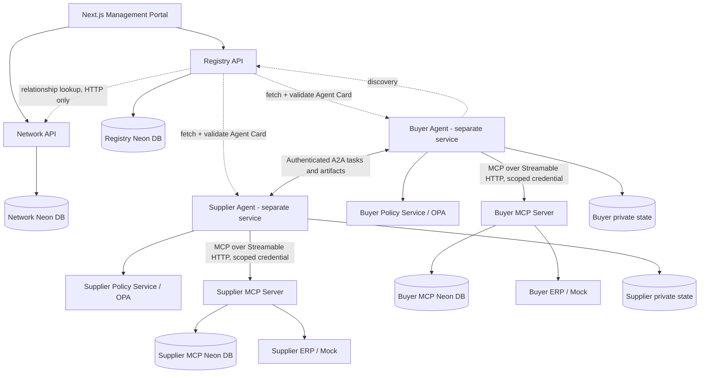

# Architecture and Deployment

## Logical topology

As of M2 (see `docs/DECISIONS.md` ADR-008), the single "Network API /
Registry" box below is split into two independently deployable services:
`network-api` (organization identity, trading relationships, service
credentials) and `registry-api` (agent registration, Agent Card
validation, capability discovery, endpoint-ownership verification,
lifecycle). They never share a database; registry-api's only
cross-service call is a read-only, internal-service-key-authenticated
relationship lookup against network-api's own HTTP API.

As of M3 (see `docs/DECISIONS.md` ADR-009), each agent's business tools
(catalogue/inventory/pricing for supplier; purchase requirements/budget
for buyer) are served by their own independently deployable MCP server —
`buyer-mcp`/`supplier-mcp` — over the official MCP SDK's Streamable HTTP
transport. Each agent calls only its own organization's MCP server,
authenticated with a network-api-issued scoped service credential; no
agent imports a tool implementation directly.



In a managed environment, separate Neon databases or rigorously isolated schemas/roles may implement each store. Self-hosted agents use their own storage. **No cross-organization SQL joins to exchange business data, and no cross-*service* database access either** — registry-api and network-api each own one database and talk to each other only over HTTP.

## Deployables

- `apps/network-api`: organization identities, organization-level trading relationships, short-lived organization-scoped service-credential issuance, public protocol schemas.
- `apps/registry-api`: agent registration, Agent Card fetch/validation (SSRF-safe), capability indexing, endpoint-ownership verification, agent lifecycle (pending/active/suspended/revoked), capability-indexed discovery (gated by a trading relationship looked up from network-api), registry audit trail. Never proxies an A2A conversation — discovery returns the real A2A endpoint URL, and agents talk to each other directly.
- `apps/buyer-agent`: independent A2A endpoint, LangGraph workflow, buyer MCP client (calls `apps/buyer-mcp` only), buyer policy client and private state.
- `apps/supplier-agent`: independent A2A endpoint, LangGraph workflow, supplier MCP client (calls `apps/supplier-mcp` only), supplier policy client and private state.
- `apps/buyer-mcp`: buyer organization's own MCP tool server (purchase requirements, budget, approved suppliers, purchase approval — a mock decision, not OPA). Independently deployable; own database (tool-invocation audit log); scoped-credential-authenticated; never serves any other organization.
- `apps/supplier-mcp`: supplier organization's own MCP tool server (catalogue search, inventory, customer price, delivery options). Independently deployable; own database (tool-invocation audit log); scoped-credential-authenticated; never serves any other organization.
- `apps/worker`: retry, timeout, inbox/outbox dispatch and reconciliation.
- `apps/portal`: Next.js management UI; Vercel.
- `services/opa`: isolated policy decisions; separate bundles and scopes per organization.
- `industries/food-wholesale`: RFQ, quote, substitution and order schema, mocks and adapters.

## Proposed repository layout

```text
aimo-brain/
  apps/
    network-api/
    registry-api/
    buyer-agent/
    supplier-agent/
    buyer-mcp/
    supplier-mcp/
    worker/
    portal/
  packages/
    agent-runtime/
    a2a-integration/
    mcp-integration/
    identity/
    authorization/
    trade-protocol/
    audit/
    database/
  industries/
    food-wholesale/
      schemas/
      adapters/mock/
      adapters/valio-aimo/  # only after permission and API access
  infrastructure/
    docker/
    railway/
    vercel/
  tests/
    contracts/
    integration/
    security/
    e2e/
  docs/
```

## Persistence

**Network database (network-api):** organizations, trading relationships, trust status, policy metadata, approval references.

**Registry database (registry-api):** agents, endpoint-verification challenges and status, indexed capabilities, registry audit trail. Deliberately does not store organization records or relationships — those are network-api's, looked up over HTTP, never joined.

**Buyer/supplier MCP databases (buyer-mcp/supplier-mcp):** each stores only its own tool-invocation audit log. Catalogue/stock/pricing/budget data itself is fictional mock data in `industries/food-wholesale`, not persisted by the MCP server — a real deployment would source it from the organization's own ERP/pricing system instead.

**Agent-owned databases:** task/checkpoint state, private prompts and tool results where permitted, inbox/outbox, quotes/agreements, approval evidence, external order references and audit. Prefer separate DB roles and encryption boundaries. Supplier ERP remains authoritative for stock, prices and orders; never treat a cached snapshot as authoritative at commit time.

**Object store:** large artifacts, attachments, signed evidence; metadata and checksums in Postgres.

**Redis:** ephemeral scheduling and worker coordination, not the source of truth for commitments. Durable task state and transactional outbox reside in Postgres.

## Deployment choices

1. **Managed:** two separately deployable Railway services and isolated Neon storage, Vercel portal. First implementation.
2. **Customer-hosted:** customer runs container and private storage/policy service; connects through public A2A endpoint or authorized relay.
3. **Bring-your-own-agent:** external A2A implementation registers and uses published business schemas. No AIMO SDK dependency required.

## Service contracts

Use OpenAPI for management endpoints and JSON Schema for business artifacts. A2A SDK handles A2A envelope/task semantics. MCP SDK handles tool transport. AIMO BRAIN defines **business payloads**, not a replacement for either standard.

## Operational boundaries

Use HTTPS/TLS, authenticated agent-to-agent calls, per-org policy evaluation, endpoint allowlisting or SSRF protections, network rate limits, scoped secret access and structured logs. Route private traffic directly where possible. Registry outage should not invalidate already established, cached and unexpired trusted endpoint configuration, but revocation must be enforced with bounded cache lifetimes.
